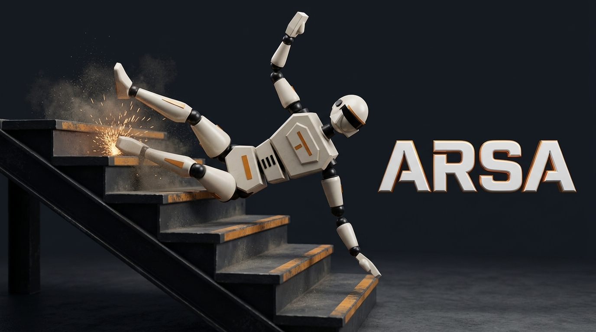
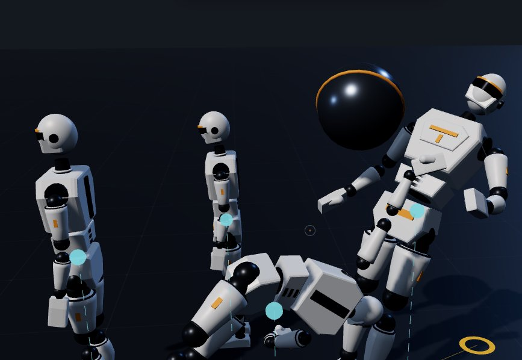
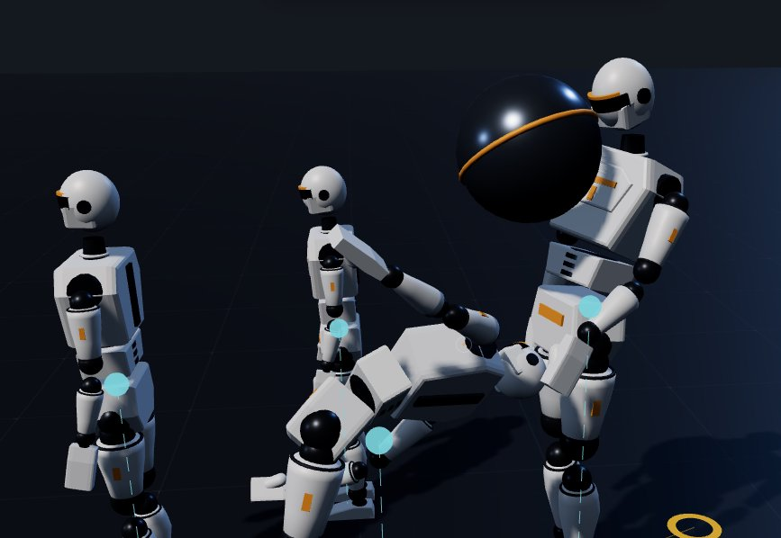
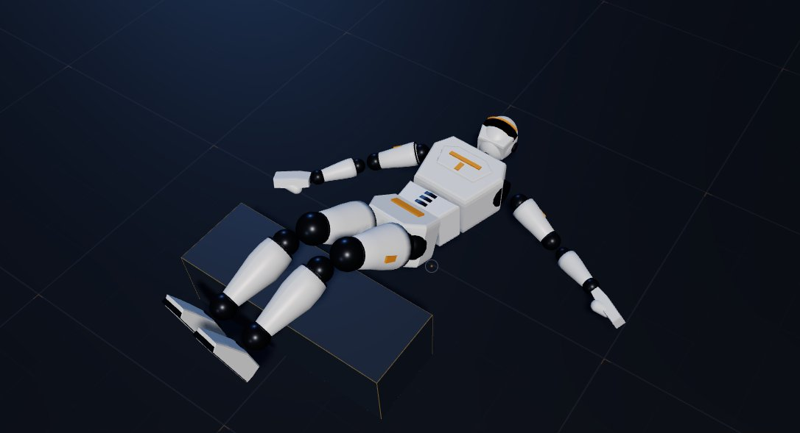
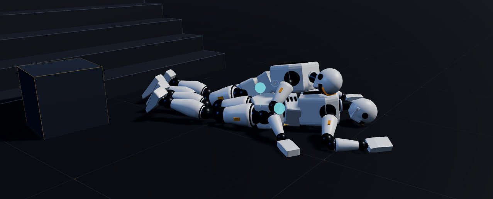

<p align="center">
  
</p>

<h1 align="center">ARSA — Active Ragdoll Simulation Architecture</h1>

<p align="center">
  <strong>Cross-engine, physically-based Active Ragdoll Engine written in Rust — inspired by NaturalMotion's Euphoria (GTA IV).</strong>
</p>

<p align="center">
  <a href="https://thecapibara.github.io/ARSA/">
    
  </a>
</p>

<p align="center">
  <a href="https://github.com/thecapibara/ARSA/actions/workflows/ci.yml">
    
  </a>
  
  
  
  
  
</p>

---

## Overview

Most ragdolls feel like rubber noodles because they are passive—limp joints, arbitrary bone masses, and zero behavioral intelligence. **ARSA** combines a deterministic, sub-stepped **XPBD rigid-body & articulated-joint solver** with **torque-limited Stable-PD muscles** and a **procedural behavioral brain** so characters physically balance, stumble, trip over obstacles, react to localized gunshot wounds, and brace for impact.

Because the entire physics & behavioral core lives in pure **Rust (`arsa-core`)**, a single codebase compiles cleanly to:
- **WebAssembly (`arsa-wasm`)** for the interactive **Three.js 3D Physics Test Chamber**
- **Native C ABI (`arsa-c-abi` / `arsa.h`)** for **Unreal Engine 5**, **Unity**, **Godot**, and custom C/C++ engines

---

## Playground Screenshots

> All screenshots below are captured directly from the live **ARSA Three.js + WebAssembly Playground** (`playground/`).

<table>
  <tr>
    <td></td>
    <td></td>
  </tr>
  <tr>
    <td></td>
    <td></td>
  </tr>
</table>

---

## Key Features

- **Anthropometric 17-Bone Humanoid Rig** — Realistic segment mass distribution, inertia tensors, strict 1-DOF hinge limits (knees & elbows never bend backward), and elliptical swing-twist cones (shoulders, hips, spine, neck, wrists, ankles).
- **Procedural `BodyProfile` Scaling (Real-Time)** — Dynamically scales bone lengths, volume-accurate limb thickness, masses, inertia, and muscle gains for any height (`140–240 cm`), mass (`40–180 kg`), and muscle ratio (`0.25–2.0×`) — from a nimble `60 kg / 165 cm` build to a `135 kg / 217 cm` heavy brute, even mid-simulation.
- **Active Balance & Capture-Point Stepping** — Tracks Center of Mass (CoM), support polygon, and Linear Inverted Pendulum Capture Point. Characters absorb light shoves, dynamically take recovery steps when pushed, and **genuinely trip** over obstacles placed behind their heels.
- **Procedural Reflexes & Localized Injury System**:
  - **Reach-for-Wound**: Shot in the left arm → left arm weakens, spine hunches toward the pain, and the right hand physically reaches across to clutch the exact wound location (torso shots curl both hands inward; leg shots buckle the knee).
  - **Vestibular Head Stabilization**: Counter-rotates neck & head toward level / chin-tuck during stumbles and falls.
  - **Brace-for-Impact & Airborne Flail**: Extends arms toward impending ground collision and windmills when launched high.
  - **Downed Writhe & Unconscious KO**: Grounded injured reactions when conscious; heavy headshots or depleted health transition to limp ragdoll physics.
- **3-Phase Biomechanical Auto Get-Up (`RECOVERING`)** — Conscious downed ragdolls wait through a realistic floor delay, roll/tuck through a crouch-lean rise back to standing, abort immediately if interrupted by a hit, and never wake when `Unconscious`.
- **Richter-Scale Earthquake Simulation** — Interactive `M 0.0–9.0` multi-frequency ground waves driving defensive crouching, stumbling, dynamic object toppling, camera shake, and procedural seismic audio.
- **GMod-Style `Placer` & `Thrower` Menus + Dynamite Explosions** — Spawn arbitrary `Curb`, `Mannequin`, `Cube`, `Sphere`, or timed `Dynamite` bundles with 4-point SAT box stacking on boxes and stairs, or launch `Cube` / `Crate` / `Sphere` projectiles.
- **Selective Distal Self-Collision** — Arms and hands physically collide against torso, chest, and back without clipping while staying stable and helicopter-free all the way up to `160 kg / 1.80×` muscle scaling.
- **Cross-Engine SDK** — Supports both **Standalone Simulation Mode** and **Host-Physics Motor Target Mode** (`arsa_world_get_joint_motor_targets`) for UE5 Chaos and Unity PhysX.

---

## Repository Structure

```text
ARSA/
├── core/                      # arsa-core: XPBD solver, 17-bone rig, Stable-PD muscles, balance & reflexes
├── bindings/
│   ├── wasm/                  # arsa-wasm: WebAssembly bindings for Three.js
│   ├── c-abi/                 # arsa-c-abi: extern "C" SDK, include/arsa.h & C smoke test
│   ├── unity/                 # Unity UPM package (P/Invoke + ArsaRagdollAgent MonoBehaviour)
│   └── unreal/ArsaRagdoll/    # Unreal Engine 5 C++ plugin (UArsaRagdollComponent)
├── playground/                # Interactive Three.js + TypeScript physics test chamber
├── docs/
│   ├── INTEGRATION.md         # C/C++, Unity, UE5 & Web integration guide
│   └── assets/banner.jpg
├── LICENSE                    # Apache License 2.0
└── NOTICE                     # Attribution notice
```

---

## Quickstart

### 1. Run Core Tests & Benchmarks
```bash
cargo test --workspace
```

### 2. Build WASM & Launch the Three.js Playground
```bash
# Compile Rust core to WebAssembly
wasm-pack build bindings/wasm --target web --out-dir ../../playground/src/wasm

# Start the interactive 3D showcase
cd playground
npm install
npm run dev
```

### 3. Build Native C ABI Library (UE5 / Unity / C++)
```bash
cargo build --release -p arsa-c-abi
```
See [docs/INTEGRATION.md](docs/INTEGRATION.md) for Unity, Unreal Engine 5, and C/C++ integration instructions.

---

## Performance Benchmarks

Measured via `cargo bench -p arsa-core --bench simulation` at `60Hz × 10 substeps = 600Hz XPBD`:

| Benchmark | Frame Time (`60Hz` step) | Notes |
| :--- | :--- | :--- |
| **`single_active_ragdoll`** | **~`0.34 ms`** | 1× 17-bone active ragdoll with full balance & reflexes |
| **`crowd_4x_standing`** | **~`0.90 ms`** | 4× active ragdolls balancing simultaneously (`68` rigid bodies) |
| **`crowd_4x_chaos_impact`** | **~`1.21 ms`** *(median)* | 4× active ragdolls under continuous multi-body collision & impacts |
| **`stacked_box_tower_5x`** | **~`0.09 ms`** | 5-box vertical stack with 4-point SAT contact solving |

---

## Playground Controls

All keyboard shortcuts use layout-independent physical keys (`e.code`).

| Input | Action |
| :--- | :--- |
| **`1` – `3`** | Grab & Drag · Shove · Punch |
| **`4` – `6`** | Pistol (9mm) · Shotgun (12ga) · Rifle (5.56) |
| **`7`** | Placer (`Curb` / `Mannequin` / `Cube` / `Sphere` / `Dynamite`) — supports stacking on boxes & stairs |
| **`8`** | Thrower (`Cube` / `Crate` / `Sphere`) |
| **`9` / `0`** | Kinetic Force Wave |
| **`T`** / **`[` `]`** | Bullet-Time (`0.15×` ↔ `1.0×`) · Simulation Speed (`0.05×` – `2.0×`) |
| **`Space` / `P`** | Pause / Resume |
| **`F`** | Orbit / Free Fly Camera (`WASD` + `Q/E` + RMB look) |
| **`M` / `D` / `Tab`** | Active/Passive Muscles · Debug Telemetry · Hide/Show HUD |
| **`R` / `+`** | Reset Scenario · Spawn Additional Ragdoll |

---

## License

Licensed under the **Apache License, Version 2.0** — see [LICENSE](LICENSE) and [NOTICE](NOTICE) for details.
Free for indie and commercial games; attribution (`NOTICE`) must be preserved in distributions and derivative works.
